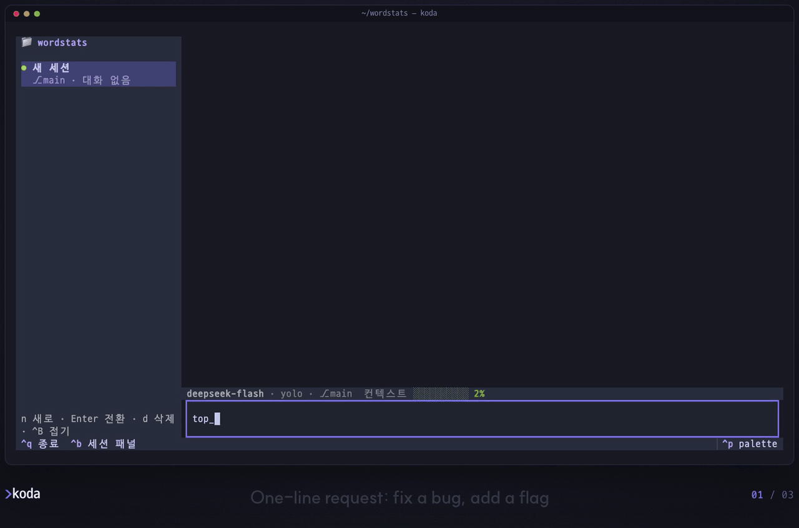
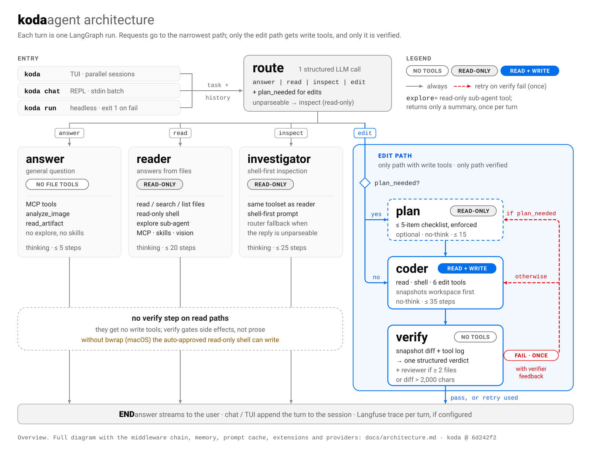

<p align="center">
  <picture>
    <source media="(prefers-color-scheme: dark)" srcset="docs/assets/logo-dark.svg">
    
  </picture>
</p>

<p align="center"><b>A routed, self-verifying coding agent for your terminal.</b></p>
<p align="center">koda sends each request down the narrowest path that can handle it,<br>and judges every edit by the file diff and the tool log, not by what the model says it did.</p>

<p align="center">
  <a href="https://github.com/DONGRYEOLLEE1/koda/actions/workflows/test.yml"></a>
  
  <a href="LICENSE"></a>
  <a href="benchmarks/README.md"></a>
</p>

<p align="center"><b>English</b> · <a href="README.ko.md">한국어</a></p>

## Install

```sh
curl -fsSL https://raw.githubusercontent.com/DONGRYEOLLEE1/koda/main/install.sh | sh
```

Installs [uv](https://docs.astral.sh/uv/) if it is missing, then koda and its TUI as an isolated uv tool on Python 3.13. Re-run to upgrade. macOS and Linux; on Windows, run it inside WSL2. Or with uv directly:

```sh
uv tool install --python 3.13 "koda[tui] @ git+https://github.com/DONGRYEOLLEE1/koda"
```

Pinning a version, installing from a clone, headless installs and uninstalling: [docs/install.md](docs/install.md). The screen tools need the `visual` extra (`koda[tui,visual]`) and a chromium build: [docs/visual.md](docs/visual.md#install).

> [!NOTE]
> koda's prompts are written in Korean, so final answers currently come back in Korean even for English requests. The CLI help and TUI labels are Korean as well.

<!-- DEMO, after the repo is public: swap the GIF for a video.
     1. Drag the English-subtitle highlight cut (koda-readme.en.mp4, 32 s, about 1.9 MB; the limit is 10 MB) into any issue or PR comment box on github.com and copy the https://github.com/user-attachments/assets/<uuid> URL it inserts.
     2. Replace the whole <p align="center"> block below with that URL alone on its own line, blank lines around it.
        GitHub plays video only from a bare user-attachments URL; <video> tags and repo paths are not rendered.
     3. Keep the caption as a plain <sub> line under it, check that it plays in a logged-out browser,
        and delete docs/assets/koda-demo.gif if nothing else uses it. -->
<p align="center">
  
  <br><sub>Real session on DeepSeek <code>deepseek-flash</code>. koda's UI and answers are in Korean; English subtitles are overlaid.</sub>
</p>

<!-- CODESPACES: after the repo is public, add
[](https://codespaces.new/DONGRYEOLLEE1/koda?quickstart=1)
(.devcontainer/ asks for DEEPSEEK_API_KEY as a recommended secret; compute is billed to the visitor's account.) -->

## Quick start

```sh
export DEEPSEEK_API_KEY=sk-...   # the only required setting
cd your-project
koda                             # TUI. Asks before any tool call outside the 8 read-only tools
```

Headless: `koda run "add a sub() function to calc.py and test it" --workspace . --yolo`. Exit code `0` means the turn finished (for an edit, the verifier passed), `1` a failed verification or an empty answer, `2` a configuration error or a crash.

## Why koda

- **Routes by intent, least privilege first.** A router sends every request to `answer`, `read`, `inspect` or `edit`. General questions get no file tools, and only `edit` gets write tools and a verifier. [How →](docs/architecture.md#routing-least-privilege-first)
- **Judges edits from the diff and the tool log.** The verifier reads a file-hash diff and the tool calls the runtime actually recorded; the coder's own summary counts as a claim, not evidence. A fail gets one retry; if the verdict is still fail, `koda run` exits 1. The verdict itself is a model call, not a guarantee. [How →](docs/architecture.md#how-an-edit-is-judged)
- **Uses the screen as evidence.** For screenshot bug fixes, refactors that must not change the screen and design matching, the coder renders the page headless, parses captures with a vision model and diffs two screens in code; the verifier reads that evidence before the coder's claims. Needs the `visual` extra and chromium. [Screen evidence →](docs/visual.md)
- **A safety floor that `--yolo` can't lift.** A static deny list runs before the approval gate. Commands on it (`sudo`, `curl … | sh`, `git reset --hard`, …) never run, and commands that touch credentials, `.env` or `git push --force` need a person, so `--yolo` refuses them. The deny list is regex-based; the OS sandbox needs Linux with bubblewrap. [Safety model →](docs/safety.md)
- **Parallel sessions in one TUI.** Each session runs on its own worker. Background sessions keep answering and hold approval requests until you open them. [TUI →](docs/features.md#tui-and-sessions)

## Benchmarks

koda is measured against [opencode](https://github.com/anomalyco/opencode) and [Hermes Agent](https://github.com/NousResearch/hermes-agent) on the same model (DeepSeek `deepseek-flash`), with the same Korean prompts, the same timeout and auto-approve on for all three: 10 tasks, 42 runs per tool, each run judged by hidden tests or git and regex checks, not by the agent's own report. The charts show where koda trails as plainly as where it leads.

<p align="center">
  <picture>
    <source media="(prefers-color-scheme: dark)" srcset="docs/assets/bench-scorecard-dark.svg">
    
  </picture>
</p>

<p align="center">
  <picture>
    <source media="(prefers-color-scheme: dark)" srcset="docs/assets/bench-run-matrix-dark.svg">
    
  </picture>
</p>

<p align="center">
  <picture>
    <source media="(prefers-color-scheme: dark)" srcset="docs/assets/bench-paired-dark.svg">
    
  </picture>
</p>

<sub>koda 0.1.0 @ 6d242f2, opencode 1.18.33, Hermes Agent 2026.9.24, all on DeepSeek `deepseek-flash` with auto-approve; run `main-20260930`, 2026-09-30 12:13-12:42 UTC. Cost = DeepSeek list price, peak basis. Small n, no significance tests. koda's router, planner, coder and verifier run with reasoning off by design while the other two think; max output tokens, step caps and output language differ too.</sub>

**Full results, method and the [fairness disclosure](benchmarks/README.md#fairness-disclosure): [benchmarks/README.md](benchmarks/README.md).** koda trails both tools on edit-task success (13 of 20 runs vs 20/20; its verifier passed 5 of the 7 failed runs), opencode on speed and on cost, and Hermes Agent on guardrail runs held. It leads only on short read-only and general questions ($0.0015 per run vs $0.0031 and $0.0050), where a new directory per run kept the other two tools' prompts out of the cache. The read-only cost bars and the guardrail outcome matrix are in [docs/architecture.md](docs/architecture.md) and [docs/safety.md](docs/safety.md). `benchmarks/charts.py` regenerates the charts above from the run's `results.json`.

## Architecture

<p align="center">
  <picture>
    <source media="(prefers-color-scheme: dark)" srcset="docs/assets/architecture-overview-dark.svg">
    
  </picture>
</p>

A LangGraph `StateGraph` built per turn. Every agent node runs the same middleware chain: step cap, approval gate with the deny list first, output trim and redaction, history trim. The full diagram with that chain, the Mermaid version, components and one edit turn step by step: [docs/architecture.md](docs/architecture.md).

## Documentation

| Topic | Guides |
|---|---|
| Getting started | [Install](docs/install.md) · [Onboarding](docs/onboarding.md) (Korean) · [TUI guide](docs/tui.md) (Korean) |
| How it works | [Features](docs/features.md) · [Architecture](docs/architecture.md) · [Safety model](docs/safety.md) · [Screen evidence](docs/visual.md) |
| Configuration | [Settings and providers](docs/configuration.md) · [Per-provider setup](docs/providers/README.md) (Korean) · [MCP](docs/mcp/README.md) (Korean) |
| Evaluation and development | [Benchmarks](benchmarks/README.md) · [Development](docs/development.md) |

What each guide covers: [docs/README.md](docs/README.md). Guides marked (Korean) are written in Korean only for now.

## License

MIT. See [LICENSE](LICENSE).
