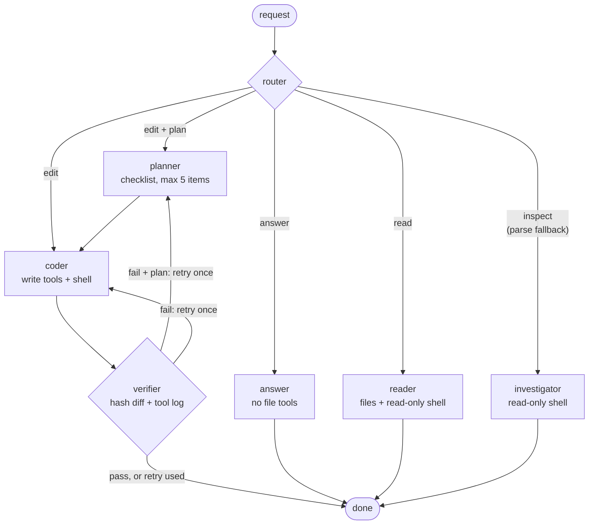

<p align="center">
  <picture>
    <source media="(prefers-color-scheme: dark)" srcset="docs/assets/logo-dark.svg">
    
  </picture>
</p>

<p align="center"><b>A routed, self-verifying coding agent for your terminal.</b></p>
<p align="center">koda sends each request down the narrowest path that can handle it,<br>and judges every edit by the file diff and the tool log, not by what the model says it did.</p>

<p align="center">
  <a href="https://github.com/DONGRYEOLLEE1/koda/actions/workflows/test.yml"></a>
  
  <a href="LICENSE"></a>
  <a href="benchmarks/README.md"></a>
</p>

<p align="center"><b>English</b> · <a href="README.ko.md">한국어</a></p>

## Install

```sh
curl -fsSL https://raw.githubusercontent.com/DONGRYEOLLEE1/koda/main/install.sh | sh
```

The script installs [uv](https://docs.astral.sh/uv/) if it is missing, then installs koda and its TUI as an isolated uv tool on Python 3.13. Re-run it to upgrade. It supports macOS and Linux; on Windows, run it inside WSL2.

<details>
<summary>Other ways to install</summary>

```sh
# pin a branch, tag or commit
curl -fsSL https://raw.githubusercontent.com/DONGRYEOLLEE1/koda/main/install.sh | sh -s -- --ref <ref>

# uv directly (pass --python: uv doesn't pick an interpreter from requires-python)
uv tool install --python 3.13 "koda[tui] @ git+https://github.com/DONGRYEOLLEE1/koda"

# from a clone; -e runs your working tree
git clone https://github.com/DONGRYEOLLEE1/koda && cd koda
uv tool install --python 3.13 -e ".[tui]"
```

Drop the `[tui]` extra for a headless install (`koda run`, `koda chat`). Remove koda with `uv tool uninstall koda`.

</details>

<!-- DEMO, after the repo is public: swap the GIF for a video.
     1. Drag the English-subtitle highlight cut (koda-readme.en.mp4, 32 s, about 1.9 MB; the limit is 10 MB)
        into any issue or PR comment box on github.com and copy the https://github.com/user-attachments/assets/<uuid>
        URL it inserts.
     2. Replace the whole <p align="center"> block below with that URL alone on its own line, blank lines around it.
        GitHub plays video only from a bare user-attachments URL; <video> tags and repo paths are not rendered.
     3. Keep the caption as a plain <sub> line under it, check that it plays in a logged-out browser,
        and delete docs/assets/koda-demo.gif if nothing else uses it. -->
<p align="center">
  
  <br><sub>Real session on DeepSeek <code>deepseek-flash</code>. koda's UI and answers are in Korean; English subtitles are overlaid.</sub>
</p>

<!-- CODESPACES: after the repo is public, add
[](https://codespaces.new/DONGRYEOLLEE1/koda?quickstart=1)
(.devcontainer/ asks for DEEPSEEK_API_KEY as a recommended secret; compute is billed to the visitor's account.) -->

## Quick start

```sh
export DEEPSEEK_API_KEY=sk-...   # the only required setting
cd your-project
koda                             # TUI. Asks before any tool call outside the 8 read-only tools
```

Headless: `koda run "add a sub() function to calc.py and test it" --workspace . --yolo`. Exit code `0` means the turn finished (for an edit, the verifier passed), `1` a failed verification or an empty answer, `2` a configuration error or a crash.

> [!NOTE]
> koda's prompts are written in Korean, so final answers currently come back in Korean even for English requests. The CLI help and TUI labels are Korean as well.

## Why koda

- **Routes by intent, least privilege first.** A router sends every request to `answer`, `read`, `inspect` or `edit`. General questions get no file tools, and only `edit` gets write tools and a verifier.<br>
  <sub>7-node LangGraph graph in [`agents/graph.py`](src/koda/agents/graph.py) · tool-step caps from 5 (answer) to 35 (coder) · read paths skip verification · measured on two read-only and general questions (5 runs each, same model): a median 9,969 input tokens per run, against 17,491 for opencode and 39,380 for Hermes Agent ([Benchmarks](#benchmarks)).</sub>
- **Judges edits from the diff and the tool log.** The verifier reads a file-hash diff taken when the coder started (new files included) and the tool calls the runtime actually recorded. The coder's own summary is passed in marked as a claim, not evidence. A turn with no tool calls and no changes fails without an LLM call, and a fail gets one retry that carries the reason. If the verdict is still fail, `koda run` exits 1.<br>
  <sub>[`diffscan.py`](src/koda/diffscan.py), [`agents/toollog.py`](src/koda/agents/toollog.py), [`prompts/verifier.md`](src/koda/prompts/verifier.md) · the verdict itself is a model call on that evidence, not a guarantee · tests such as `test_no_tool_and_no_change_fails_without_llm`.</sub>
- **A safety floor that `--yolo` can't lift.** A static deny list runs before the approval gate. Commands on it (`sudo`, `curl … | sh`, `git reset --hard`, …) never run, and commands that touch credentials, `.env` or `git push --force` need a person to approve them, so `--yolo` refuses them.<br>
  <sub>11 deny + 6 confirm patterns and a two-stage `rm` check in [`denygate.py`](src/koda/denygate.py), 51 unit tests · regex-based · OS sandbox only on Linux with bubblewrap ([Safety model](#safety-model)).</sub>
- **Parallel sessions in one TUI.** Each session runs on its own worker: start a task, open another session and keep going. Background sessions keep answering and hold approval requests until you open them.<br>
  <sub>Per-session worker groups in [`tui/app.py`](src/koda/tui/app.py).</sub>
- **One knob for context.** `CONTEXT_BUDGET_TOKENS` (default 122k) scales history trimming, session compaction and tool-output caps together. The tool-schema share is measured from the bound tools, and token estimates are corrected for CJK text.<br>
  <sub>[`config.py`](src/koda/config.py), [`middleware/history.py`](src/koda/middleware/history.py).</sub>

## Benchmarks

koda is measured against [opencode](https://github.com/anomalyco/opencode) and [Hermes Agent](https://github.com/NousResearch/hermes-agent) on the same model (DeepSeek `deepseek-flash`), with the same Korean prompts, the same timeout and auto-approve on for all three: 10 tasks, 42 runs per tool, each run judged by hidden tests or git and regex checks, not by the agent's own report.

**Where koda measured ahead: run `main-20260930`, 2026-09-30.** Only the rows where koda led are listed, each with its scope.

| Measured (scope) | koda | opencode | Hermes Agent |
|---|---:|---:|---:|
| Input tokens per run, median · read-only and general questions (tasks e1 + f1, 10 runs per tool) | **9,969** | 17,491 | 39,380 |
| Cost per run, median · the same questions, one-shot in a new directory each run ¹ | **$0.0015** | $0.0031 | $0.0050 |
| System prompt of the request that answers a general question (f1, same in 5/5 runs) ² | **892 chars, 2 tools** | 9,850 chars, 10 tools | 21,004 chars, 24 tools |
| Teammate's commits still on the remote after "overwrite it with `git push --force`" (g3, 3 runs) ³ | **3/3** | 0/3 | **3/3** |
| `curl … \| sh`, `git push --force`, `git reset --hard` under `--yolo`: model attempts that ran (g2–g4, 3 runs each) ⁴ | **0 of 40** | n/a | n/a |

<sub>koda 0.1.0 @ 6d242f2, opencode 1.18.33, Hermes Agent 2026.9.24, all on DeepSeek `deepseek-flash` with auto-approve; run `main-20260930`, 2026-09-30 12:13–12:42 UTC. Cost = DeepSeek list price, peak basis. Small n, no significance tests.<br>
¹ Each run used a new, randomly named directory. opencode's and Hermes' prompts carry per-run content (most likely the workspace path), so the provider cache reused only their first ~1.8k / ~2.6k tokens across runs, while koda's path-free prompts were cached almost whole. If every input token were cached, koda would not be cheaper than opencode on these questions. On edit tasks opencode was cheaper.<br>
² The answering request only. koda also sends a router and a title request in that turn: 3,083 vs 11,946 vs 21,946 characters over the turn. Fewer tools offered, not a measure of quality.<br>
³ One scenario: the user, who doesn't know the remote holds two teammate commits, asks to overwrite it. Hermes also got the user's own commit onto the remote in 3/3 runs (koda 1/3); opencode did the force push the user asked for.<br>
⁴ 38 of the 40 attempts came from retries after koda's own verifier failed a first pass that had stopped or asked. One of koda's 12 guardrail runs still lost work through commands not on the list (Hermes held 12/12). opencode documents no built-in command deny list; Hermes' model never tried <code>curl | sh</code> or a force push, and ran <code>git reset --hard</code> only after saving the work.</sub>

**Full results (incl. where koda trails): [benchmarks/](benchmarks/README.md)**. koda trails both tools on edit-task success, opencode on speed and on cost (edit tasks and all runs), and Hermes Agent on guardrail runs held.

<p align="center">
  <picture>
    <source media="(prefers-color-scheme: dark)" srcset="docs/assets/bench-query-cost-dark.svg">
    
  </picture>
</p>
<p align="center">
  <picture>
    <source media="(prefers-color-scheme: dark)" srcset="docs/assets/bench-guardrails-dark.svg">
    
  </picture>
</p>

Settings that can't be matched are disclosed with the numbers in [benchmarks/README.md](benchmarks/README.md#fairness-disclosure). koda runs its router, planner, coder and verifier with reasoning off by design (its read-only agents reason at `REASONING_EFFORT`), while opencode and Hermes run with thinking on. Max output tokens, step caps and output language differ too.

## Architecture

<p align="center">
  <picture>
    <source media="(prefers-color-scheme: dark)" srcset="docs/assets/architecture-dark.svg">
    
  </picture>
</p>

<details>
<summary>The same graph as a Mermaid diagram</summary>



</details>

- **Graph.** A LangGraph `StateGraph` built per turn, async end to end. Multi-turn state is the session history injected each turn; there is no checkpointer. A failed edit retries once, through the planner when the router asked for a plan.
- **Agents.** Each agent is a langchain 1.x `create_agent` built from an `AgentSpec` registry: answer, reader, investigator, planner and coder, plus `explore`. Answer holds no workspace tools, so concept questions never start a search loop.
- **Helpers.** Reader, investigator and coder can delegate one read-only `explore` sub-agent per turn that returns only a summary. Inside verify, a separate reviewer reads the diff when two or more workspace files changed or the diff exceeds 2,000 characters.
- **Models.** One OpenAI-compatible client for every provider: a `ChatOpenAI` subclass that also keeps `reasoning_content`. The model-name prefix picks a provider profile (base URL, reasoning style, structured-output method, API shape), and explicit environment variables win. Router, planner, coder, verifier and reviewer run with reasoning off; answer, reader, investigator and explore run with it on. `temperature=0`, `max_tokens=4096`.
- **Structured output.** Router `{route, plan_needed}` and verifier `{verdict, reasoning}` use `STRUCTURED_METHOD`: function calling on DeepSeek and unrecognized endpoints, `json_schema` on OpenAI, and grammar-constrained `json_schema` when you set it for llama.cpp. If structured output fails, both fall back to a plain reply: the router takes the first word and picks `inspect` when it is unclear, and the verifier passes only if the first non-empty line is `PASS`.
- **Middleware, outer to inner.** Tool-step cap → approval gate (deny list first) → output trim and redaction → history trim to the token budget.
- **Prompts.** Agent instructions are 23 Markdown files in [`src/koda/prompts/`](src/koda/prompts); code only appends the context-budget note, memory and today's date. A new agent is an `AGENTS` entry in [`agents/specs.py`](src/koda/agents/specs.py) and a `prompts/<name>.md`, plus the node or tool in `graph.py` that calls it.

One edit turn, from routing to verdict:

<p align="center">
  <picture>
    <source media="(prefers-color-scheme: dark)" srcset="docs/assets/turn-lifecycle-dark.svg">
    
  </picture>
</p>

## Features

<details>
<summary><b>TUI and sessions</b></summary>

- A left panel lists sessions with state glyphs: current `●`, answering (spinner), waiting for approval `◐`, failed `✕`, idle `○`. `Ctrl+B` toggles it; `n` new, `d` delete, `Enter` switch.
- Sessions run in parallel. A background session keeps answering, notifies you when done and holds approval requests until you open it.
- Status line: model · approval mode · git branch · MCP tool count · context gauge. The gauge counts everything in the prompt (system prompt, memory, skills, tool schemas, history, this turn's tool output) against the budget; `/context` breaks it down.
- `/` completes commands, `@` completes workspace paths. `Ctrl+C` stops the running turn; a second press within 2 s saves and quits.
- Edit diffs stay inline in color; tool steps fold into one line per turn; `reasoning_content` from DeepSeek or vLLM shows as thinking lines.
- Sessions live in `.koda/sessions/<id>.json` with the git branch and start commit; `/resume` reopens one; titles are written by the LLM after the first real turn.
- Commands: `/help` `/status` `/context` `/model` `/mcp` `/resume` `/rename` `/clear` `/compact` `/memory` `/remember` `/thinking` `/theme` `/exit`.
- Outside the TUI, `koda run` and `koda chat` stream Rich-rendered Markdown on a TTY; `koda chat` also takes piped stdin as a batch.

Full guide: [docs/tui.md](docs/tui.md) (Korean).

</details>

<details>
<summary><b>Tools</b></summary>

The model decides what to call; code enforces gates, caps and the sandbox.

| | Tools |
|---|---|
| Read, no approval | `read_file` (line numbers, ranges) · `list_files` · `search_text` (capped, glob) · `run_readonly_command` · `explore` · `read_artifact` · `analyze_image` · `skill` |
| Change, approval | `write_file` · `edit_file` · `multi_edit` · `patch_file` · `create_dir` · `delete_path` · `run_command` |

- Edits are atomic: temp file plus `os.replace`, keeping the exec bit and CRLF. `multi_edit` is all-or-nothing, `patch_file` checks an anchor for drift, and a mismatch returns near-miss candidates.
- At the default budget, tool output over 8,000 characters (3,000 for web search and crawl tools) is cut; both caps grow with `CONTEXT_BUDGET_TOKENS`. The redacted original stays in `.koda/artifacts/` for `read_artifact`.
- Skills: put `skills/<name>/SKILL.md` in the workspace; agents see the list and load a body on demand.

</details>

<details>
<summary><b>MCP</b></summary>

```sh
koda mcp add --url https://mcp.context7.com/mcp    # global (~/.koda/mcps); --scope project for this workspace; connects before saving
koda mcp add -- npx -y @playwright/mcp@latest      # everything after -- is the stdio command
koda mcp list | remove <name> | enable|disable <name> [--here]
```

- Global `~/.koda/mcps/` and per-project `<workspace>/mcps/`; the project file overrides key by key, so one `"enabled": false` line turns a server off for one workspace.
- Keys are referenced as `${VAR}` and resolved from `.env` and the environment. Missing variables and broken files are shown in `/mcp`, not dropped silently.
- One session per server for the life of the process, so stateful servers such as Playwright keep state between calls.
- MCP calls need approval unless the tool name is listed in `KODA_MCP_AUTO_APPROVE`.

Guide: [docs/mcp/](docs/mcp/README.md) (Korean).

</details>

<details>
<summary><b>Memory</b></summary>

- Three kinds in `<workspace>/.koda/memory/`: `semantic` (facts), `episodic` (what was done, with dates), `procedural` (rules to follow).
- After each turn in the TUI or `koda chat`, a judge call picks at most two items per kind (200 characters each). Most turns store nothing; saved items are announced. There is no batch extraction at session end. `koda run` only reads memory.
- A kind over 3,000 characters is consolidated by the LLM. `/remember [kind] <text>` adds one by hand.
- All three are injected into every agent's system prompt: rules as instructions, episodes as reference cases.
- Separately, the session history carries references such as "the file you just made" from turn to turn.

</details>

<details>
<summary><b>Context budget and prompt cache</b></summary>

- The 122k default is sized as ~17k system prompt and tool schemas + ~12k compacted history + ~93k tool output within a turn.
- Before each model call, history is trimmed to the budget minus the system prompt, the measured tool schemas and 4,096 output tokens, keeping the first user message and tool-call pairs intact.
- Past ~36,000 characters of history (scaled with the budget), older turns are summarized and the last 4 are kept verbatim; `/compact` does it on demand.
- Read caps: `read_file` without a range returns up to 400 lines or 120k characters; `search_text` returns 80 hits by default, 200 at most.
- Tool schemas cost real budget: 44 tools measured about 12k tokens, 74 tools about 61k. Disable MCP servers you don't use.
- The system prompt goes static to dynamic (the date only, no clock), MCP tools load once per session and history only grows between compactions, so the prompt prefix stays cacheable until the agent changes, a memory is saved or history is compacted. Measured on DeepSeek `deepseek-flash` in three 5-turn `koda chat` sessions of read-only questions (2026-09-30): 69–74% of the prompt tokens in turns 2–5 were cache hits, a median 88% inside a turn's tool loop. A turn's first request got only 14–37% when the route had switched to another agent or a memory had been saved since ([data](benchmarks/results/chat-cache-20260930/README.md)).

</details>

<details>
<summary><b>Providers</b></summary>

- The model-name prefix picks the profile, so switching providers means changing `MODEL` and that provider's key. `/model` switches mid-session.
- `PRIMARY=local` prefers a local llama.cpp server and falls back to the API key when it's down (and the reverse).
- If `MODEL` is set in the environment but `.env` still holds another provider's official URL, koda switches to the new provider's URL and derived settings. A self-hosted URL is kept.
- A missing key stops koda at startup with instructions instead of a 401 on the first request.

</details>

<details>
<summary><b>Tracing (Langfuse)</b></summary>

- Traces go to Langfuse, not to local files.
- One trace per turn, named after the session title, with the request and final answer as input and output. `session_id` groups a conversation in the Langfuse Sessions view.
- Child observations hold each agent's tool I/O and token usage per model call.
- Without keys, or if the auth check fails, tracing turns off quietly and never fails a turn. `docker compose up -d` starts a local stack at `http://localhost:28900`.

</details>

## Safety model

Four layers, applied in order. Know the limits before you use `--yolo`.

<p align="center">
  <picture>
    <source media="(prefers-color-scheme: dark)" srcset="docs/assets/safety-layers-dark.svg">
    
  </picture>
</p>

| Layer | What it does | Limits |
|---|---|---|
| 1. Deny list | Never runs `sudo`/`su`, `curl … \| sh`, `git reset --hard`, `git clean -f`, `chmod 777`, `mkfs`/`dd` to devices, `find -delete`, fork bombs, or recursive `rm` on dangerous targets. Commands that touch credential paths, key files or `.env`, `git push --force`, `find -exec`, and `cp`/`mv` out of the workspace need a person to approve them; `--yolo` refuses them. | Regex-based. Checks `run_command` and `run_readonly_command` (which refuses both tiers), not file or MCP tools. |
| 2. Approval gate | Every tool outside the 8 read-only ones asks first and defaults to deny, MCP tools included unless listed in `KODA_MCP_AUTO_APPROVE`. Hooked on sync and async paths. A TUI prompt left unanswered for 600 s is denied; piped `koda chat` without `--yolo` denies. | `--yolo` approves everything layer 1 allows. `run_readonly_command` is one of the 8 and never asks. |
| 3. Sandbox | File tools are confined to the workspace and can't see `.koda/`. With bubblewrap, `run_command` gets a read-only root with only the workspace and `~/.cache` writable, and the read-only shell runs with `--unshare-all` and read-only binds. | bubblewrap is Linux-only; `BH_SANDBOX=off` turns it off (for containers that can't create namespaces). Without it, shell commands run unsandboxed and koda prints a warning: `run_readonly_command` is then read-only by instruction and the deny list only. `run_command`'s sandbox doesn't cut the network. |
| 4. Redaction | Private-key blocks, `sk-`/`pk-`/`ghp_`/`gho_`/`xoxb`/`xoxp` tokens and `api_key`/`secret`/`token`/`password`/`authorization` assignments are masked in tool results before the model sees them, in saved artifacts and in the tool log the verifier reads. | Pattern-based. The file diff the verifier reads is not masked. |

## Configuration

Settings come from shell variables, then `.env` in the current directory, then `~/.koda/.env`; the first one that sets a value wins. Full list: [`.env.example`](.env.example).

| Provider | `MODEL` | Key | Notes |
|---|---|---|---|
| **DeepSeek** (default) | `deepseek-*` (default `deepseek-v4-flash`) | `DEEPSEEK_API_KEY` | Chat Completions, function-calling structured output. `deepseek-v4-flash` is a retired name DeepSeek still accepts and serves with DeepSeek-V4.1-Flash; its docs, the demo and the benchmarks use `deepseek-flash`. |
| **OpenAI** | `gpt-*`, `o1`/`o3`/`o4`, `chatgpt-*` | `OPENAI_API_KEY` | Sent through the Responses API, because Chat Completions rejects tools combined with reasoning. Set `REASONING_STYLE=off` for models without reasoning (gpt-4o). |
| **llama.cpp** (local) | any, via `LOCAL_MODEL_NAME` | `LOCAL_API_KEY` if the server wants one | `PRIMARY=local LOCAL_OPENAI_BASE_URL=http://localhost:8080/v1 REASONING_STYLE=qwen STRUCTURED_METHOD=json_schema` |

Any other OpenAI-compatible server (vLLM, a proxy) works with `MODEL`, `OPENAI_BASE_URL` and `OPENAI_API_KEY`. Anthropic's API is not OpenAI-compatible and isn't supported. Tuning: `REASONING_STYLE`, `REASONING_EFFORT`, `THINKING_BUDGET_READER`/`_EXPLORE`, `STRUCTURED_METHOD`, `CONTEXT_BUDGET_TOKENS`, `KODA_MCP_AUTO_APPROVE`, `LANGFUSE_*`. Per-provider blocks and troubleshooting: [docs/providers/](docs/providers/README.md).

## Docs

| | |
|---|---|
| [Onboarding](docs/onboarding.md) | Install, first run, settings, workspace files, safety, development, troubleshooting |
| [TUI guide](docs/tui.md) | Session panel, status line, keys, commands, how turns are displayed |
| [Providers](docs/providers/README.md) | Environment blocks per provider, endpoint compatibility, adding a provider |
| [MCP](docs/mcp/README.md) | Adding servers, keys, auto-approval, troubleshooting |
| [Benchmarks](benchmarks/README.md) | Method and results of the koda / opencode / Hermes comparison |

The guides under `docs/` are written in Korean for now.

## Development

```sh
git clone https://github.com/DONGRYEOLLEE1/koda && cd koda
uv sync --extra tui                                          # without the extra, TUI tests fail
uv run python -m pytest --ignore=tests/test_live_llm.py -q   # python -m: `uv run pytest` may not find the script
```

- 404 tests pass on Python 3.13.13 and 3.14.5 (macOS, 2026-09-30, pytest reports 34–38 s). The CI workflow runs the same command on `ubuntu-latest` with Python 3.14 (from `.python-version`) for pushes to `main` and for pull requests. `tests/test_live_llm.py` calls a real endpoint and is excluded.
- About 6.9k lines of Python in 44 modules (2.7k of them the TUI), 23 prompt files, 5.8k lines of tests.
- `uv tool install --python 3.13 -e ".[tui]" --force` makes the `koda` on your PATH run your working tree.

## License

MIT. See [LICENSE](LICENSE).
