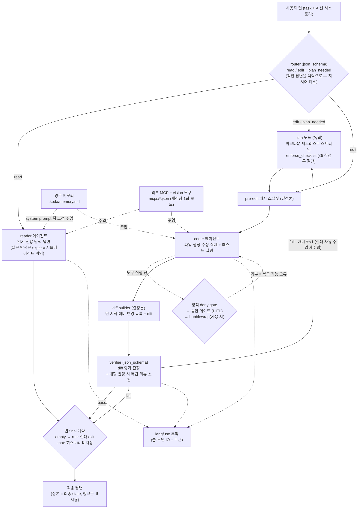
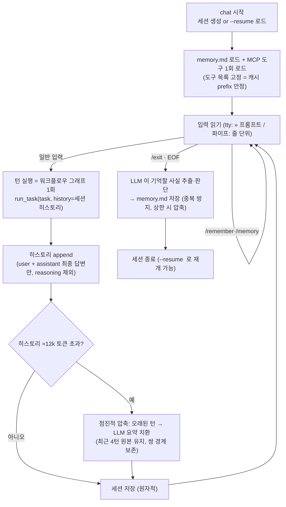

# koda

**langchain 1.x 기반 분기 멀티에이전트 coding-agent koda.** **router** 가 요청을 분류해 읽기는
**reader**, 파일 변경은 **coder** 로 라우팅하고, **verifier 는 부수효과가 있는 edit 경로에만** 건다
(부수효과 없는 분석의 산문 품질 평가는 비용 대비 신뢰할 수 없어 생략). 각 에이전트는 도구를
**자율 호출**하며, **외부 MCP 도구**(문서 조회·웹검색)와 워크스페이스 **스킬**을 스스로 판단해 쓴다.
복잡 편집은 **독립 plan 노드**가 마크다운 체크리스트를 스트리밍한 뒤 coder 가 순서대로 수행한다.
답변은 **스트리밍**되고(TTY 는 Rich Live 마크다운, 파이프/배치는 plain), 모든 툴·모델 입출력과
**단계별 토큰 사용량**은 **langfuse** 로 추적된다.

**멀티턴 대화(`chat`)와 계층형 메모리**: 세션이 히스토리를 유지·영속해(`--resume` 재개) "방금 만든
파일에 …" 같은 지시어를 해소하고, `/remember` + 세션 종료 시 LLM 이 저장하는 **영구 메모리**
(`.koda/memory.md`)가 새 세션에도 주입된다. 히스토리가 길어지면 **점진적 문맥 압축**(오래된 턴을
LLM 요약으로 치환)이 걸리고, 안정 prefix + append-only 구조로 llama.cpp **프롬프트 캐시**를 극대화한다
(실측: 2턴째 입력 84~87% 히트).

## 요구사항

- Python >= 3.13 (개발 기본 3.14), [uv](https://docs.astral.sh/uv/), Docker + Compose (langfuse)
- (운영) MacBook llama.cpp OpenAI 호환 엔드포인트. 미가용 시 OpenAI API 폴백(`.env`).

## 빠른 시작

**설치 (어디서든 `koda` 실행)**

```bash
uv tool install .                          # 격리 설치 → koda 명령이 PATH 에
uv tool install "koda[tui]"                #   TUI 포함 (textual)
mkdir -p ~/.config/koda && cp .env.example ~/.config/koda/.env   # 전역 설정(한 번)
#   설정 탐색: CWD/.env → ~/.config/koda/.env → 환경변수
```

**개발 (레포에서)**

```bash
uv sync                                    # 환경 구성 (editable + dev)
cp .env.example .env                       # 로컬 LLM / langfuse 설정
docker compose up -d                       # langfuse 스택 기동 → http://localhost:3002
uv run pytest --ignore=tests/test_live_llm.py   # 유닛만 빠르게
```

**실행** (설치본은 `koda`, 레포에서는 `uv run koda`)

```bash
# 단발 실행 — 답변 스트리밍(TTY: 마크다운 렌더링) + 단계 표시, 추적은 langfuse 로
koda run "calc.py에 두 수를 빼는 sub 함수를 추가해줘" --workspace . --yes
koda run "이 프로젝트 구조를 설명해줘" --workspace .

# 멀티턴 대화 (세션 저장/재개, 영구 메모리)
koda chat --workspace . --yes
#   » calc.py 만들어 add 함수 작성해줘
#   » 방금 만든 파일에 mul 함수도 추가해줘      ← 히스토리로 지시어 해소
#   » /remember 함수 이름은 snake_case 로     ← 영구 메모리 (새 세션에도 적용)
#   » /exit                                  ← 종료 시 LLM 이 기억할 사실 자동 추출
koda chat --workspace . --resume <session-id>   # 세션 재개

# TUI
koda tui --workspace . --no-mcp
#   한 화면: 대화 스트림 + 상태/검증/메모리/세션 패널 + 위험 도구 승인 modal
#   슬래시 커맨드: /help · /compact(문맥 압축) · /clear · /remember · /memory · /exit
#   --resume 로 chat 세션도 이어받는다

# 외부 MCP 없이 로컬만(빠름)
koda run "..." --workspace . --no-mcp
```

`chat` 은 stdin 이 tty 가 아니면 줄 단위 배치로 실행돼 파이프 기반 검증이 가능하다
(`printf '턴1\n턴2\n/exit\n' | koda chat ...`). 비대화형에서 `--yes` 가 없으면
위험 도구는 안전하게 거부된다(승인 질문이 파이프 입력을 삼키지 않도록).

`--yes` 를 빼면 위험 도구(파일 쓰기·삭제·명령 실행·**외부 MCP 호출**) 실행 전에 승인을 물어본다.

`tui` 는 Textual 기반 사람용 인터페이스로, `run`/`chat` 을 대체하지 않는다(자동화·파이프
계약은 그대로). 턴 실행은 worker thread 안에서 기존 실행 코어(`run_task`)를 CLI 와 동일하게
호출하고, worker→UI 전달은 thread-safe 메시지만 쓴다. 위험 도구 승인은 modal 로 받는다
(ESC·timeout = 거부, `--yes` 는 chat 과 동일한 자동 승인 의미 — confirm 등급은 여전히 차단).
textual 미설치 시 `tui` 명령이 설치 안내만 출력하며 다른 경로는 영향받지 않는다 —
`plan/TEXTUAL_TUI_PLAN.md`

## 아키텍처 (langchain 1.x)

| 계층                     | 구현                                                                                                                                                                                                                                                                                                                                                                                                                                                                                                                           |
| ------------------------ | ------------------------------------------------------------------------------------------------------------------------------------------------------------------------------------------------------------------------------------------------------------------------------------------------------------------------------------------------------------------------------------------------------------------------------------------------------------------------------------------------------------------------------ |
| **LLM**            | `init_chat_model` (로컬 llama.cpp 우선 + OpenAI 폴백) — `llm.py`                                                                                                                                                                                                                                                                                                                                                                                                                                                          |
| **도구**           | `@tool`, 용도별 파일: `filesystem.py`(읽기) · `shell.py`(명령) · `edit.py`(파일 변경) · `artifact.py`(절단 원문 재조회) · `skill.py`(스킬 본문 조회) · `vision.py`(이미지 분석)                                                                                                                                                                                                                                                                                                                             |
| **에이전트**       | `AgentSpec` 레지스트리 + `create_agent` — **`agents/` 패키지**(specs·streaming·graph·verify·recall). **reader**/**coder** + 컨텍스트 격리용 **explore**(위임 탐색, 턴당 1회 캡) + **planner**(읽기 전용 계획 수립); **verifier** 는 diff 기반 단일 판정                                                                                                                                                                                                                         |
| **분기**           | langgraph`StateGraph`: router → {reader → END \| [plan →] coder → verifier(fail 시 **plan 재수립** 후 재시도 1회)}. 복잡 편집은 **독립 plan 노드**(마크다운 체크리스트 스트리밍, `enforce_checklist` 로 5개 상한 결정론 집행(개수는 복잡도 비례로 planner 가 판단)), 대형 변경은 verify 에 **독립 리뷰** 소견 추가. 전 경로 **async** — `plan/PLANNER_AGENT.md`                                                                                                                             |
| **구조화 출력**    | router`{route, plan_needed}`·verifier `{verdict, reasoning}` 를 **llama.cpp `json_schema`(GBNF 문법 강제)** 로 — 형식 밖 토큰은 생성 자체가 불가. 실패 시 텍스트 폴백 존치 (plan 은 체크리스트 직접 생성 + 결정론 파싱)                                                                                                                                                                                                                                                                                          |
| **실행 결과 계약** | `astream_agent` 는 답변 정본을 **최종 state 의 마지막 AIMessage** 에서 수집(스트림 청크는 표시 전용) — 중첩 스트림 청크 유실(실측 결함)에 면역. 빈 final 은 `no_content\|length_truncation\|unknown` 으로 분류돼 실패 처리                                                                                                                                                                                                                                                                                            |
| **MCP**            | **`mcps/*.json` 폴더 일괄 로드** → 외부 MCP 도구를 **reader·coder·planner**(+explore 위임)에 주입 — `mcp.py` (아래 [MCP 확장](#mcp-확장))                                                                                                                                                                                                                                                                                                                                                                   |
| **스킬**           | **`<workspace>/skills/*/SKILL.md` 발견**(frontmatter name+description + 본문) → 이름+설명을 reader·coder·planner 프롬프트에 주입, 에이전트가 관련성을 **스스로 판단**해 `skill(name)`(읽기 전용)으로 전체 지침 로드(progressive disclosure). Claude Code Agent Skills 모델 — `skills.py`, `plan/SKILLS.md`                                                                                                                                                                                             |
| **프롬프트**       | 외부 파일`prompts/*.md` (system + `verifier_task`·`coder_retry` 템플릿) — 코드 인라인 금지                                                                                                                                                                                                                                                                                                                                                                                                                             |
| **안전**           | ①**정적 deny gate**(`denygate.py`) — `sudo`·`curl\|sh`·대량 삭제 등은 `--yes` 로도 우회 불가, secret 접근은 대화형 승인 필수 → ② `PermissionMiddleware` — 읽기 외 모든 도구 HITL 게이트(default-deny) → ③ **bubblewrap**(설치 시) — 셸 명령을 루트 read-only OS 격리로 실행. + workspace 샌드박스(`.koda` 비노출)                                                                                                                                                                          |
| **견고성**         | `ToolOutputTrimMiddleware` — 절단 시 **원문을 `.koda/artifacts/` 에 보존**(secret redaction)하고 에이전트가 `read_artifact` 로 범위 재조회 · 빈 응답은 **no_think 강등 재시도** · reader/explore 는 **에이전트별 reasoning 예산**(`thinking_budget_tokens` 요청 파라미터, 기본 reader=1024·explore=512, `.env` 의 `THINKING_BUDGET_READER/EXPLORE` 로 재정의 — llama-server 는 `--reasoning-budget` 플래그 없이 기동해야 적용) · 파일명 오질의 시 유사 후보 반환 · CLI 하트비트(30s) |
| **멀티턴**         | `Session`(`.koda/sessions/<id>.json`, 원자적 저장·`--resume`) — 히스토리에 user/assistant **최종 답변만**(reasoning 미저장 = interleaved thinking 규칙) — `session.py`                                                                                                                                                                                                                                                                                                                                     |
| **메모리**         | `Memory`(`.koda/memory.md`) — `/remember` + 세션 종료 시 **LLM 이 기억 가치 판단·추출**(패턴 4). system prompt 뒤 고정 위치 주입(캐시 친화). 항목 단위 중복 방지(멱등), 상한 초과 시 LLM 통합 압축 — `memory.py`                                                                                                                                                                                                                                                                                           |
| **문맥 압축**      | 히스토리 임계(≈12k tok) 초과 시 오래된 턴을**LLM 요약으로 치환**, 최근 4턴 원본 유지(패턴 5). user/assistant 쌍 경계 보존                                                                                                                                                                                                                                                                                                                                                                                               |
| **캐싱**           | llama.cpp 프롬프트 캐시 활용: 안정 prefix(system+memory+도구 고정) + append-only 히스토리 +**세션당 MCP 1회 로드**. 실측 멀티턴 캐시 히트 84~87%                                                                                                                                                                                                                                                                                                                                                                         |
| **스트리밍/진행**  | `stream_mode=["messages","values"]` — 토큰 표시는 청크, 답변 정본은 최종 state. **TTY 는 Rich Live 마크다운 실시간 렌더링**(transient 중간 프레임 + finalize 렌더링본 1회 = 본문 단일 출력 불변식), non-TTY 는 기존 plain 스트리밍. 단계 전환(route/plan/read/edit/verify/review)·하트비트 진행 표시, thinking 모델의 **reasoning 무출력 구간은 "🤔 생각 중… (~N tok)" status** 로 가시화(TTY 전용) — `plan/MARKDOWN_STREAMING.md`                                                                         |
| **vision**         | `analyze_image` 도구(§확장): 이미지(png/jpg/webp/gif, ≤5MB)를 구조화 JSON 으로 분석. **llama.cpp 가 mmproj 와 함께 기동돼야 활성**(`/props` 프로브) — 미지원이면 복구 가능한 안내 반환                                                                                                                                                                                                                                                                                                                            |
| **TUI**            | `tui/` 패키지(app·runner·model·widgets) — Textual 앱(extra: `tui`). worker thread 에서 `asyncio.run(run_task)`, 콜백→`post_message`(thread-safe), 승인 modal 은 `threading.Event` 브리지로 동기 approver 계약 유지. 대화 스트림은 `Markdown.get_stream`, `think:N`/heartbeat 는 status strip 전용 — `plan/TEXTUAL_TUI_PLAN.md`                                                                                                                                                                           |
| **추적**           | **langfuse** (docker-compose): 에이전트/툴/모델 IO + **단계별 토큰** — `tracing.py`                                                                                                                                                                                                                                                                                                                                                                                                                             |
| **설정**           | `.env` + pydantic-settings (타입 검증) — `config.py`                                                                                                                                                                                                                                                                                                                                                                                                                                                                      |

## 워크플로우

한 턴의 실행 흐름 (단발 `run` = 이 그래프 1회, 멀티턴 `chat` = 아래 [세션 루프](#멀티턴과-메모리)가 이 그래프를 반복 호출):



- **모든 판단(라우팅·도구 선택·MCP 사용·탐색·변경·검증)은 LLM이 자율 수행**하고, 코드는 게이트 집행·샌드박스·추적만 담당한다.
- 파일 도구는 워크스페이스 루트에 **샌드박스**되고(`.venv`/`.git` 등 제외), 읽기 외 도구는 실행 전 **승인 게이트**를 통과한다.
- 서브에이전트 추가 = `AGENTS` 레지스트리 항목 + `prompts/<name>.md` (PLAN §8.1).

## 도구와 승인 게이트 (HITL)

승인은 **화이트리스트 방식(default-deny)** 이다: 아래 "안전" 3개만 무승인으로 실행되고,
**그 외 모든 도구**(내장 위험 도구 + MCP + 미래에 주입될 이름 모를 도구까지)는 실행 전
`PermissionMiddleware` 가 approver 에게 묻는다. `--yes` 면 자동 승인, 거부하면 도구는 실행되지
않고 오류 메시지가 에이전트에게 돌아가 대안을 모색한다(실행이 죽지 않음).

| 도구                                                  | 사용 에이전트          | 승인(HITL)                 | 설명                                                                                                                                                                                                                                                  |
| ----------------------------------------------------- | ---------------------- | -------------------------- | ----------------------------------------------------------------------------------------------------------------------------------------------------------------------------------------------------------------------------------------------------- |
| `read_file`                               | reader·coder·planner | 불필요 (SAFE)              | 파일 읽기.**없는 파일이면 유사 후보 제시**, 유일 후보면 그 내용까지 반환                                                                                                                                                                        |
| `list_files`                              | reader·coder·planner | 불필요 (SAFE)              | 파일 목록 (`.venv`/`.git`/`.koda` 등 제외, `max_depth`/`max_entries` 캡)                                                                                                                                                                                                                |
| `search_text`                             | reader·coder·planner | 불필요 (SAFE)              | 텍스트 검색 (`file:line:내용`)                                                                                                                                                                                                                      |
| `write_file`                              | coder                  | **필요**             | 파일 생성/전체 덮어쓰기                                                                                                                                                                                                                               |
| `edit_file`                               | coder                  | **필요**             | 부분 치환 (old 는 정확히 1회 일치)                                                                                                                                                                                                                    |
| `create_dir`                              | coder                  | **필요**             | 디렉토리 생성                                                                                                                                                                                                                                         |
| `delete_path`                             | coder                  | **필요**             | 파일/디렉토리 삭제 (복구 불가)                                                                                                                                                                                                                        |
| `run_command`                             | coder                  | **필요** + deny gate | 명령 실행.**정적 deny gate 선행**: `sudo`·`curl\|sh`·대량 삭제 등은 `--yes` 로도 차단, secret 접근(`.ssh`/`.env` 등)은 대화형 승인 필수. bubblewrap 설치 시 OS 격리 실행. **워크스페이스 `.venv` 우선**(거짓 성공 증거 방지) |
| `explore`                                           | reader·coder          | 불필요 (SAFE)              | **탐색 전용 서브에이전트에 위임**(턴당 1회) — 넓은 탐색을 격리된 컨텍스트에서 수행하고 요약만 반환                                                                                                                                             |
| `analyze_image`                                     | reader·coder·planner | 불필요 (SAFE)              | 이미지 구조화 분석(§3.2). llama.cpp mmproj 미탑재면 복구 가능한 안내 반환                                                                                                                                                                            |
| `read_artifact`                                     | reader·coder·planner | 불필요 (SAFE)              | 절단된 도구 출력의 원문(`.koda/artifacts/`)을 줄 범위로 재조회                                                                                                                                                                                   |
| `skill`                                             | reader·coder·planner | 불필요 (SAFE)              | 관련 스킬의`SKILL.md` 본문을 읽기 전용으로 로드 (`<workspace>/skills/` 에 스킬이 있을 때만 노출)                                                                                                                                                  |
| MCP 도구 전부 (`query-docs`, `web_search_exa` 등) | reader·coder·planner | **필요**             | 외부 네트워크 호출.`mcps/*.json` 에서 로드되며, SAFE 목록 밖이므로 이름과 무관하게 자동 게이트                                                                                                                                                      |

- 모든 도구 경로는 `workspace.resolve()` 로 워크스페이스 루트에 **샌드박스**된다(루트 밖 접근 차단).
  `.koda/`(세션·메모리·artifact)는 파일 도구 목록·검색·diff 에 노출되지 않는다.
- 도구 출력은 8,000자에서 절단하되 **원문을 `.koda/artifacts/` 에 보존**(secret redaction + 크기 상한)하고,
  에이전트가 필요 판단 시 `read_artifact` 로 범위 재조회한다 — 증거는 잃지 않고 컨텍스트만 아낀다.
- 게이트는 sync·async(`wrap_tool_call`/`awrap_tool_call`) 양쪽 훅에 걸려 MCP(async) 경로에서도 우회되지 않는다.
- verifier 는 도구 없이 diff 기반 단일 판정이므로 HITL 이 걸리지 않고, router 는 도구를 호출하지 않는다.

### explore — 도구형 서브에이전트 (컨텍스트 격리)

reader·coder 에게 `explore(question)` 은 도구 하나로 보이지만, 호출하면 내부에서 별도
서브에이전트(`AGENTS["explore"]`)가 떠서 **자기만의 컨텍스트**로 넓은 탐색(다중 파일 열람·검색·MCP
조회)을 수행하고 **요약만** 반환한다. 대량의 파일 덤프·검색 로그는 서브에이전트 컨텍스트에 격리되어
메인 히스토리를 오염·비대화시키지 않는다 (Claude Code 의 Agent 툴과 같은 패턴).

- 그래프 노드가 아니라 **도구 레벨** — route 가 관여하지 않고, 호출한 에이전트에게 동기적으로 요약이 돌아온다
- **턴당 1회 캡** (koda 결정론) — reader↔explore 무한 핑퐁 방지. 초과 시 "지금까지 수집한 정보로 답하라" 오류 반환
- explore 자신에게는 explore 도구를 주지 않는다 — **재귀 위임 불가**
- 단일 파일 확인은 위임하지 않고 직접 `read_file` 을 쓰도록 도구 설명이 유도한다 — 발동 조건은 "여러 파일을 훑어야 하는 넓은 탐색"

## MCP 확장

외부 MCP 서버를 **프롬프트처럼 파일로 단일화**한다. `mcps/` 폴더의 `*.json`(또는 `*.yaml`)을 일괄 로드해
**reader·coder·planner**(+explore 위임)에 도구로 주입하며, LLM 이 최신 문서 조회·웹검색이 필요하다고 판단하면 스스로 호출한다.
(reader 에도 주는 이유: "최신 버전 기준으로 분석해줘" 같은 read 작업이 문서 조회 수단 없이는 낡은 학습
지식으로 오답을 낸다 — 실측으로 확인된 갭이다.)

```jsonc
// mcps/exa.json — 웹 검색
{ "mcpServers": { "exa": { "url": "https://mcp.exa.ai/mcp" } } }

// mcps/context7.json — 최신 라이브러리 문서
{ "mcpServers": { "context7": { "url": "https://mcp.context7.com/mcp" } } }
```

- `url` 만 있으면 `transport=streamable_http`, `command` 면 `stdio` 로 자동 채운다.
- 서버별로 격리 로드(+타임아웃)해 하나가 죽어도 나머지는 살린다. 오프라인이면 조용히 건너뛴다.
- MCP 도구는 SAFE 목록 밖이라 **승인 게이트 대상**(외부 호출)이며, 실행/입출력이 langfuse 에 추적된다.
- 새 MCP 추가 = `mcps/<name>.json` 파일 하나. 코드 수정 불필요.

## 검증(verifier) 설계

**검증은 부수효과 게이트다** — 워크스페이스를 변경하는 **edit 경로에만** 걸리고, 부수효과 없는 read
경로는 검증 없이 답변으로 끝난다(분석 산문의 품질 평가는 수십 초 비용 대비 신뢰할 수 없는 고무도장에
불과했다 — 실측). verifier 는 tool-loop(왕복 2~3회)을 돌지 않는다.

증거 수집은 **전 구간 결정론**이다: coder 진입 시 파일 해시 스냅샷(메모리 내) → 종료 후 재비교로
**변경 목록(A/M/D) + unified diff** 를 산출한다(신규 파일 본문 포함 — plain `git diff` 가 놓치는
untracked 구멍이 없다). verifier 는 이 diff 를 증거로 **단 한 번의 구조화 판정**
(`with_structured_output(Verdict, method="json_schema")` — llama.cpp 가 문법으로 강제)을 내린다.
요청 밖 파일 변경(스코프 위반)은 변경 목록에 기계적으로 드러나 fail 사유로 검토된다.
plan 노드가 수립한 **체크리스트(plan_text)도 판정 증거에 포함**돼 항목 이행 여부가 검토되며,
fail 시 재시도는 coder 재실행이 아니라 **이전 계획+실패 사유를 주입한 plan 재수립**부터 시작한다.
변경이 크면(2파일+ 또는 diff 2,000자+) **독립 리뷰어**(diff 만 보는 별도 호출)의 소견이 판정 입력에
추가된다. 실행 에이전트(coder)가 자체 실행한 테스트 결과는 답변에 담겨 판정 근거가 된다.
구조화 판정이 실패하면 텍스트 파싱으로 폴백한다(첫 줄이 정확히 PASS 일 때만 pass — 안전 기본값은 fail).
verifier·reviewer 는 **라이브러리 버전·API 의 존재/최신 여부를 학습 지식만으로 단정하지 않는다** —
FAIL 은 diff·실행 결과로 입증 가능한 결함에만 내린다(낡은 지식이 정상 리팩터링을 오탐→불필요한 재계획
루프로 몰던 실측 결함을 프롬프트로 차단).

> 참고: 로컬 Qwen 은 추론 모델이라 사소한 판정에도 수백 개의 추론 토큰을 생성한다. 짧은 `max_tokens` 캡(512)은
> 정상 추론까지 잘라 빈 판정→오탐을 냈다(실측). 그래서 지연은 **왕복 횟수**(→ 1회)로 줄이되, 퇴행성 무한 사고
> 폭주(실측 300s+ 무출력 생성)만 끊도록 **넉넉한 전역 상한 4096 토큰**을 모든 모델 호출에 둔다.

## 멀티턴과 메모리

계획·조사 문서: `plan/MEMORY_MULTITURN.md`, `plan/research/memory-multiturn-caching.md`.

```
<workspace>/.koda/
  ├─ memory.md            # 영구 메모리 — /remember + 세션 종료 시 LLM 자동 추출. 새 세션에 항상 주입
  └─ sessions/<id>.json   # 세션(히스토리+턴 기록) — chat --resume <id> 로 재개
```

`chat` 의 세션 루프 — 위 [워크플로우](#워크플로우) 그래프를 턴마다 반복 호출한다:



- **interleaved thinking 규칙**: 턴 안에서는 reasoning 이 유지되고(에이전트 루프), 턴 경계에서는
  제거된다 — Qwen chat template 이 이를 네이티브 구현하며, 세션 히스토리에도 최종 답변만 저장해 이중 보장.

  

  (그림: Turn 1 안의 Step 2·3 입력에는 Reasoning 1·2 가 유지되지만, Turn 2 의 입력에는 이전 턴의
  Reasoning 이 모두 제거되고 tool call/result 와 최종 Answer 만 남는다. 출처: GLM interleaved thinking)
- **압축은 임계 도달 시에만**: 압축이 프롬프트 prefix 를 깨므로(캐시 미스 1회) 매턴 하지 않는다.
- **캐시 친화 구조**: [고정] system prompt + 프로젝트 메모리 + 도구 정의 → [append-only] 대화 히스토리.
  MCP 도구는 세션당 1회 로드해 도구 목록을 고정한다. llama.cpp 운영 시 `--cache-prompt --cache-reuse 256`
  명시 권장(기본 활성이지만 재현성).
- 검증 시나리오: `scenario/06~08*.json` (멀티턴 지시어 해소 · 세션 간 메모리 영속 · read→edit 전환).

## 추적 (langfuse)

로컬 파일로 저장하지 않고 **langfuse**(`http://localhost:3002`)에 기록한다. 실행 1건 = 1 trace 이며,
각 에이전트(reader/coder/verifier)의 **툴 호출 입출력**(내장 도구 + MCP)과 **모델 호출별 토큰 사용량**(input/output/total)이
관측(observation)으로 남아 재구성·비용 분석이 가능하다.
