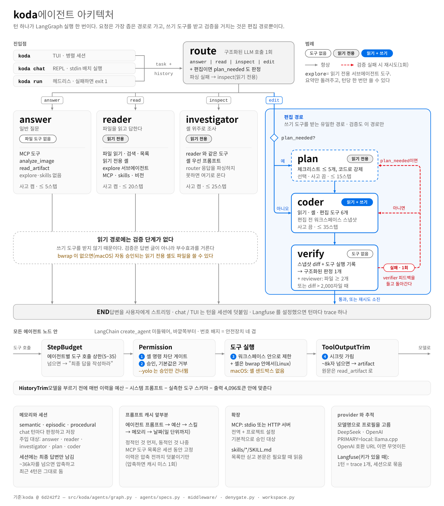
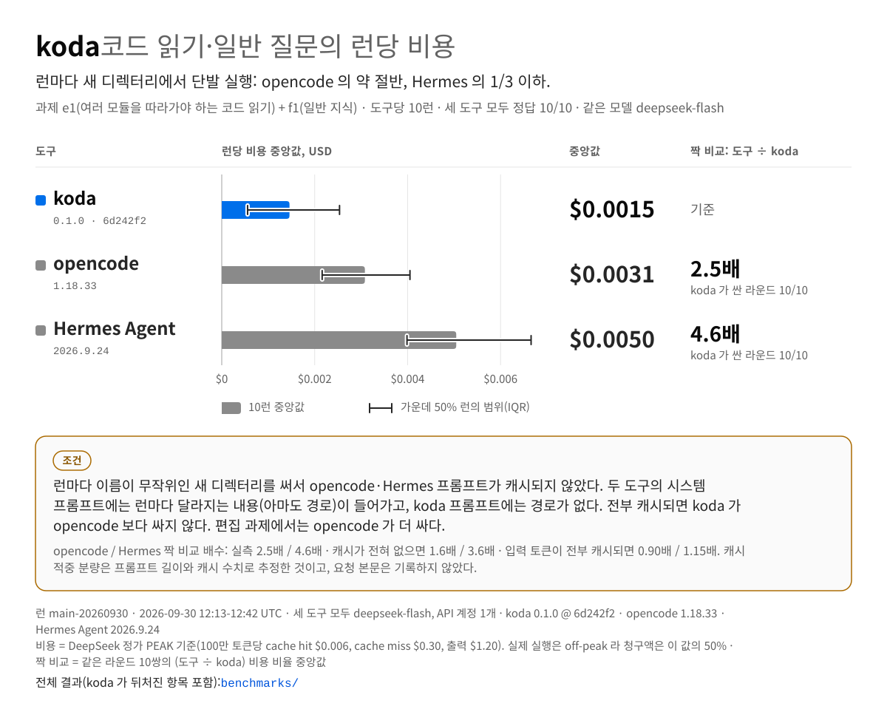
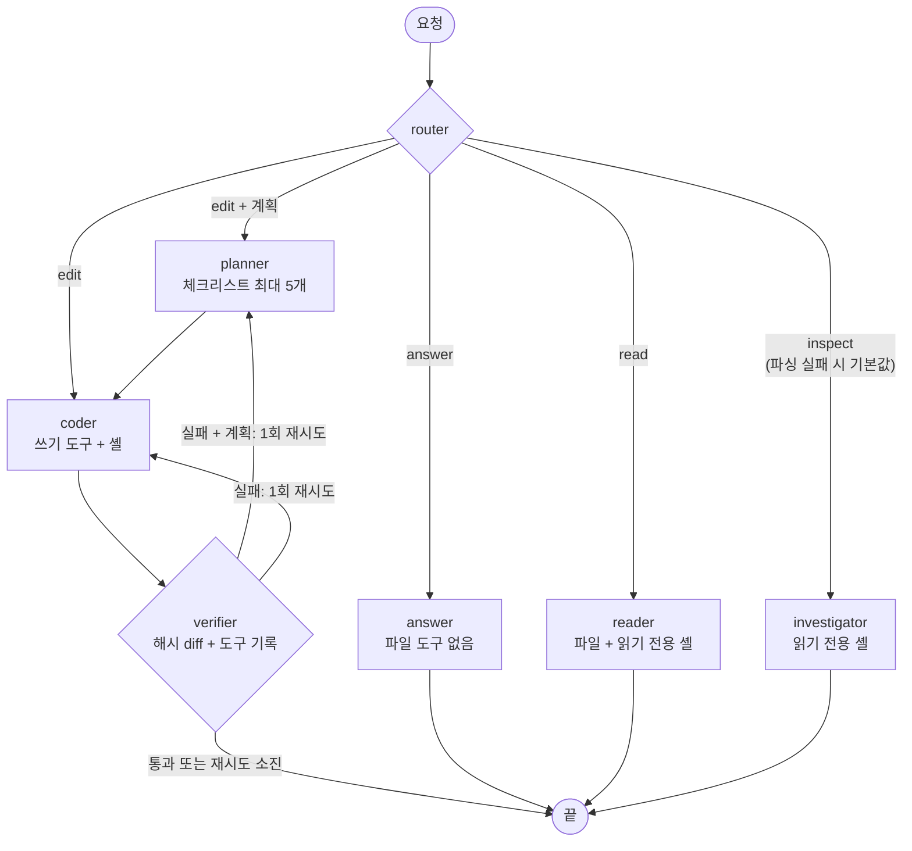
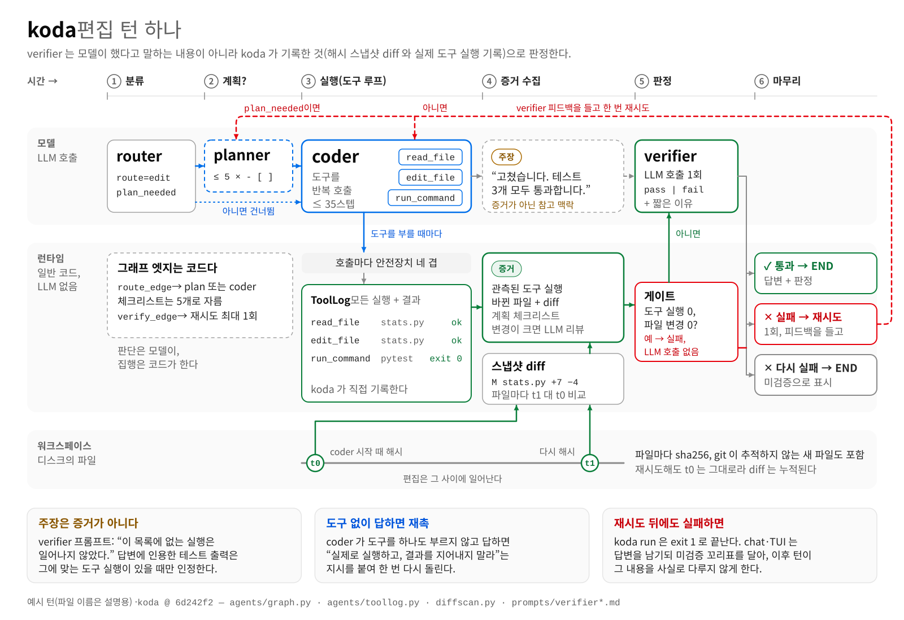

# 아키텍처

[English](architecture.md) · **한국어** · [README](../README.ko.md) 로 돌아가기

  <picture>
    <source media="(prefers-color-scheme: dark)" srcset="assets/architecture-ko-dark.svg">
    
  </picture>

[라우팅](#라우팅-권한은-필요한-만큼만) · [Mermaid 로 본 그래프](#mermaid-로-본-그래프) · [구성 요소](#구성-요소) · [편집을 판정하는 방식](#편집을-판정하는-방식)

## 라우팅: 권한은 필요한 만큼만

라우터가 모든 요청을 `answer`·`read`·`inspect`·`edit` 중 하나로 보낸다. 일반 질문에는 파일 도구를 주지 않고, 쓰기 도구와 검증은 `edit` 경로에만 붙는다.

- 라우팅은 [`agents/graph.py`](../src/koda/agents/graph.py) 의 7노드 LangGraph 그래프로 구현돼 있다.
- 도구 스텝 상한은 에이전트별로 5(answer)~35(coder)다.
- 읽기 경로는 검증을 건너뛴다.
- 같은 모델로 코드 읽기·일반 질문 2개(각 5회)를 잰 결과 런당 입력 토큰 중앙값이 9,969 로, opencode 17,491, Hermes Agent 39,380 보다 적었다([벤치마크](../benchmarks/README.md)).
- 일반 질문(f1, 5런 모두 같음)에 답하는 요청의 시스템 프롬프트는 892자·도구 2개로, opencode 는 9,850자·도구 10개, Hermes Agent 는 21,004자·도구 24개였다. 답변 요청만 잰 값이고, koda 는 같은 턴에 router·제목 요청을 더 보내므로 턴 전체로는 3,083자 대 11,946자 대 21,946자다. 도구를 적게 싣는다는 뜻이지 품질 지표가 아니다.

  <picture>
    <source media="(prefers-color-scheme: dark)" srcset="assets/bench-query-cost-ko-dark.svg">
    
  </picture>

이 질문들의 비용 차이는 provider 캐시 조건에 달려 있다. 런마다 이름이 무작위인 새 디렉터리를 썼다. opencode·Hermes 는 프롬프트에 런마다 달라지는 내용(아마도 워크스페이스 경로)을 넣어서 런 사이 캐시가 앞부분 약 1.8k·2.6k 토큰만 재사용했고, 경로가 없는 koda 프롬프트는 거의 통째로 캐시됐다. 입력이 전부 캐시됐다고 가정하면 이 질문들에서도 koda 가 opencode 보다 싸지 않다. 편집 과제에서는 opencode 가 더 쌌다. 조건과 전체 표는 [benchmarks/README.md](../benchmarks/README.md#results-run-main-20260930)(영문).

## Mermaid 로 본 그래프

위 다이어그램과 같은 그래프다.

## 구성 요소

- **그래프.** 턴마다 새로 만드는 LangGraph `StateGraph` 이고 전 경로가 async 다. 멀티턴 상태는 checkpointer 없이 세션 이력을 매 턴 주입해서 잇는다. 편집이 검증에 실패하면 한 번만 다시 시도하는데, 라우터가 계획이 필요하다고 본 요청이면 planner 부터 다시 탄다.
- **에이전트.** 각 에이전트는 `AgentSpec` 레지스트리로 만든 langchain 1.x `create_agent` 다. answer·reader·investigator·planner·coder 와 `explore` 가 있다. answer 는 워크스페이스 도구를 쥐지 않아 개념·용어 질문에 검색 루프를 돌지 않는다.
- **보조 에이전트.** reader·investigator·coder 는 턴당 한 번 읽기 전용 `explore` 서브에이전트에 탐색을 맡길 수 있고, 돌아오는 것은 요약뿐이다. verify 안에서는 워크스페이스 파일이 2개 이상 바뀌었거나 diff 가 2,000자를 넘으면 별도 reviewer 가 diff 를 한 번 더 읽는다.
- **모델.** provider 와 상관없이 OpenAI 호환 클라이언트 하나를 쓴다. `reasoning_content` 까지 보존하도록 `ChatOpenAI` 를 확장한 클래스다. 모델명 접두로 provider 프로필(base_url·reasoning 방식·구조화 출력 방식·API 형태)을 고르고, 같은 이름의 환경변수를 주면 그 값이 이긴다. router·planner·coder·verifier·reviewer 는 사고를 끄고, answer·reader·investigator·explore 는 `REASONING_EFFORT` 수준으로 켠다. `temperature=0`, `max_tokens=4096`.
- **구조화 출력.** router `{route, plan_needed}` 와 verifier `{verdict, reasoning}` 는 `STRUCTURED_METHOD` 방식으로 받는다. DeepSeek 와 프로필이 없는 엔드포인트는 function calling, OpenAI 는 `json_schema` 가 기본이고, llama.cpp 는 `json_schema` 를 지정하면 문법으로 형식을 강제한다. 구조화 출력이 실패하면 둘 다 일반 응답으로 폴백한다. router 는 첫 단어를 보고 애매하면 `inspect` 로 보내고, verifier 는 비어 있지 않은 첫 줄이 `PASS` 일 때만 통과시킨다.
- **미들웨어(바깥 → 안).** 도구 스텝 상한 → 승인 게이트(차단 목록 먼저) → 출력 트림·시크릿 가림 → 토큰 예산에 맞춘 이력 트림.
- **프롬프트.** 에이전트 지시문은 [`src/koda/prompts/`](../src/koda/prompts) 의 마크다운 파일이고, 코드는 컨텍스트 예산 안내·메모리·오늘 날짜만 덧붙인다. 에이전트를 새로 붙이려면 [`agents/specs.py`](../src/koda/agents/specs.py) 의 `AGENTS` 항목과 `prompts/<이름>.md` 를 추가하고, 그 에이전트를 부르는 노드나 도구를 `graph.py` 에 둔다.

## 편집을 판정하는 방식

verifier 는 coder 가 시작할 때 떠 둔 해시 스냅샷 대비 diff(새 파일 포함)와 런타임이 실제로 기록한 도구 호출을 받는다. coder 가 쓴 요약은 "증거가 아닌 주장" 이라고 표시해서 넘긴다. 도구를 한 번도 안 쓰고 바뀐 것도 없으면 LLM 을 부르지 않고 실패 처리하고, 실패하면 그 이유를 들고 한 번 다시 시도한다. 그래도 판정이 fail 이면 `koda run` 은 exit 1 로 끝난다. 턴에서 화면 도구를 썼으면 도구 기록 끝에 화면 증거 블록(렌더·파싱·비교 호출과 그 첫 줄, 첫 편집 전에 기준 렌더가 있었는지, 마지막 비교 전문)이 붙고, verifier 는 화면에 대한 coder 의 주장보다 이 블록을 먼저 본다([visual.ko.md](visual.ko.md)).

- 코드: [`diffscan.py`](../src/koda/diffscan.py), [`agents/toollog.py`](../src/koda/agents/toollog.py), [`prompts/verifier.md`](../src/koda/prompts/verifier.md).
- 최종 판정은 이 증거를 받은 모델 호출이라 정답을 보장하지는 않는다.
- `test_no_tool_and_no_change_fails_without_llm` 등의 테스트로 이 동작을 고정해 두었다.

편집 턴 하나가 분류부터 판정까지 흘러가는 순서:

  <picture>
    <source media="(prefers-color-scheme: dark)" srcset="assets/turn-lifecycle-ko-dark.svg">
    
  </picture>

벤치마크의 편집 과제에서 koda 가 실패한 7런 중 5런은 verifier 가 통과시켜 `koda run` 이 exit 0 으로 끝났다(거짓 성공). 자세한 내용은 [benchmarks/README.md](../benchmarks/README.md#results-run-main-20260930)(영문).
