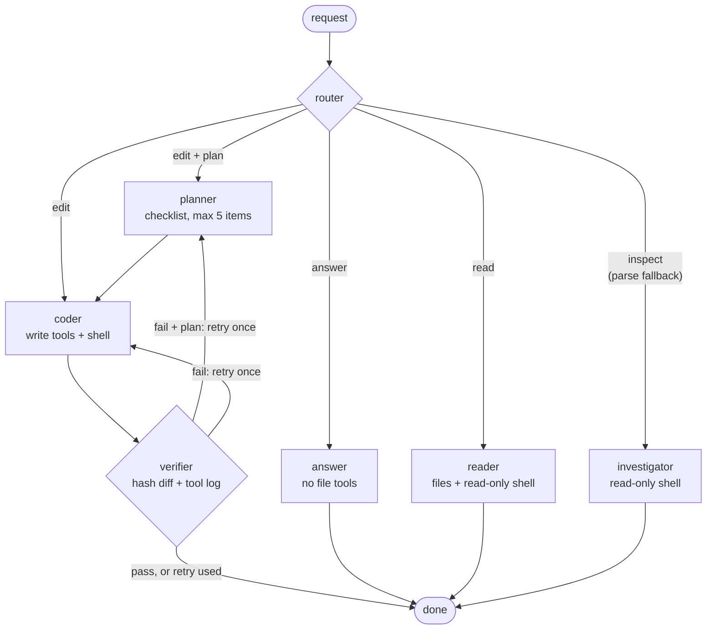

# Architecture

**English** · [한국어](architecture.ko.md) · back to the [README](../README.md)

  <picture>
    <source media="(prefers-color-scheme: dark)" srcset="assets/architecture-dark.svg">
    
  </picture>

[Routing](#routing-least-privilege-first) · [The graph as Mermaid](#the-graph-as-mermaid) · [Components](#components) · [How an edit is judged](#how-an-edit-is-judged)

## Routing: least privilege first

A router sends every request to `answer`, `read`, `inspect` or `edit`. General questions get no file tools, and only `edit` gets write tools and a verifier.

- 7-node LangGraph graph in [`agents/graph.py`](../src/koda/agents/graph.py).
- Tool-step caps from 5 (answer) to 35 (coder).
- Read paths skip verification.
- Measured on two read-only and general questions (5 runs each, same model): a median 9,969 input tokens per run, against 17,491 for opencode and 39,380 for Hermes Agent ([benchmarks](../benchmarks/README.md)).
- On the general question (f1, same in 5/5 runs) the request that answers carried a system prompt of 892 characters and 2 tools, against 9,850 characters and 10 tools for opencode and 21,004 characters and 24 tools for Hermes Agent. That is the answering request only: koda also sends a router and a title request in that turn, 3,083 vs 11,946 vs 21,946 characters over the turn. Fewer tools offered, not a measure of quality.

  <picture>
    <source media="(prefers-color-scheme: dark)" srcset="assets/bench-query-cost-dark.svg">
    
  </picture>

The cost gap on these questions depends on the provider cache. Each run used a new, randomly named directory. opencode's and Hermes' prompts carry per-run content (most likely the workspace path), so the provider cache reused only their first ~1.8k / ~2.6k tokens across runs, while koda's path-free prompts were cached almost whole. If every input token were cached, koda would not be cheaper than opencode on these questions. On edit tasks opencode was cheaper. Conditions and the full table: [benchmarks/README.md](../benchmarks/README.md#results-run-main-20260930).

## The graph as Mermaid

The same graph as the diagram above.

## Components

- **Graph.** A LangGraph `StateGraph` built per turn, async end to end. Multi-turn state is the session history injected each turn; there is no checkpointer. A failed edit retries once, through the planner when the router asked for a plan.
- **Agents.** Each agent is a langchain 1.x `create_agent` built from an `AgentSpec` registry: answer, reader, investigator, planner and coder, plus `explore`. Answer holds no workspace tools, so concept questions never start a search loop.
- **Helpers.** Reader, investigator and coder can delegate one read-only `explore` sub-agent per turn that returns only a summary. Inside verify, a separate reviewer reads the diff when two or more workspace files changed or the diff exceeds 2,000 characters.
- **Models.** One OpenAI-compatible client for every provider: a `ChatOpenAI` subclass that also keeps `reasoning_content`. The model-name prefix picks a provider profile (base URL, reasoning style, structured-output method, API shape), and explicit environment variables win. Router, planner, coder, verifier and reviewer run with reasoning off; answer, reader, investigator and explore run with it on, at `REASONING_EFFORT`. `temperature=0`, `max_tokens=4096`.
- **Structured output.** Router `{route, plan_needed}` and verifier `{verdict, reasoning}` use `STRUCTURED_METHOD`: function calling on DeepSeek and unrecognized endpoints, `json_schema` on OpenAI, and grammar-constrained `json_schema` when you set it for llama.cpp. If structured output fails, both fall back to a plain reply: the router takes the first word and picks `inspect` when it is unclear, and the verifier passes only if the first non-empty line is `PASS`.
- **Middleware, outer to inner.** Tool-step cap → approval gate (deny list first) → output trim and redaction → history trim to the token budget.
- **Prompts.** Agent instructions are 23 Markdown files in [`src/koda/prompts/`](../src/koda/prompts); code only appends the context-budget note, memory and today's date. A new agent is an `AGENTS` entry in [`agents/specs.py`](../src/koda/agents/specs.py) and a `prompts/<name>.md`, plus the node or tool in `graph.py` that calls it.

## How an edit is judged

The verifier reads a file-hash diff taken when the coder started (new files included) and the tool calls the runtime actually recorded. The coder's own summary is passed in marked as a claim, not evidence. A turn with no tool calls and no changes fails without an LLM call, and a fail gets one retry that carries the reason. If the verdict is still fail, `koda run` exits 1.

- Code: [`diffscan.py`](../src/koda/diffscan.py), [`agents/toollog.py`](../src/koda/agents/toollog.py), [`prompts/verifier.md`](../src/koda/prompts/verifier.md).
- The verdict itself is a model call on that evidence, not a guarantee.
- Pinned by tests such as `test_no_tool_and_no_change_fails_without_llm`.

One edit turn, from routing to verdict:

  <picture>
    <source media="(prefers-color-scheme: dark)" srcset="assets/turn-lifecycle-dark.svg">
    
  </picture>

In the benchmark's edit tasks, koda's verifier passed 5 of the 7 failed edit runs, so `koda run` exited 0 on them (false success). Details: [benchmarks/README.md](../benchmarks/README.md#results-run-main-20260930).
